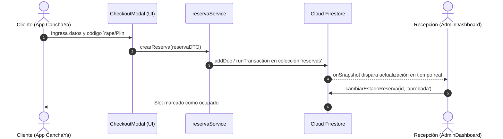

# /tech-spec — Especificación Técnica Profesional para CanchaYa

Este skill guía la creación de **Especificaciones Técnicas (Tech Specs / RFCs / Design Docs)** de nivel profesional adaptadas estrictamente al contexto, arquitectura y modelos de **CanchaYa**.

---

## 📌 Contexto Técnico del Proyecto CanchaYa

Toda especificación técnica debe construirse respetando las bases de este proyecto:

- **Propósito:** Plataforma móvil de reserva y gestión de canchas deportivas (grass sintético y natural) en **Cajamarca, Perú**.
- **Stack Tecnológico:**
  - **Framework:** Expo SDK 57 (`expo: ^57.0.0`)
  - **Core:** React Native `0.86.3` / React `19.2.3`
  - **Lenguaje:** TypeScript `~6.0.3` (Tipado estricto, cero `any`)
  - **BaaS / Backend:** Firebase JS SDK `^12.18.0` (Cloud Firestore + Firebase Auth)
  - **Iconografía:** `lucide-react-native`
  - **Estilos:** `StyleSheet.create` con **Tema Dark Deportivo** (Fondo `#0D1117`, Superficies `#1E293B`, Verde Grass `#10B981`, Ámbar `#F59E0B`, Azul `#3B82F6`).
  - **Pagos Admitidos:** Billeteras digitales peruanas (**Yape** y **Plin**).
  - **Sectores de Cajamarca:** Baños del Inca, Av. Hoyos Rubio, Santa Apolonia, Qhapaq Ñan, etc.

---

## 🔄 Flujo de Trabajo Obligatorio (Workflow CanchaYa)

```
[Nuevo Requerimiento en CanchaYa]
                 │
                 ▼
[Paso 1. Inspección del Codebase] ──────────▶ (Revisar src/types, src/services, src/components, App.tsx)
                 │
                 ▼
[Paso 2. ❓ Entrevista Técnica CanchaYa] ──▶ (Formular preguntas de negocio, canchas, pagos Yape/Plin, roles)
                 │  ▲ (Repreguntar hasta eliminar toda duda)
                 ▼  │
[Paso 3. Redacción del TechSpec CanchaYa] ──▶ (Aplicar la Plantilla Oficial de CanchaYa)
                 │
                 ▼
[Paso 4. Trade-offs y Decisiones Firebase] ─▶ (Evaluar onSnapshot vs getDocs, transacciones, offline)
                 │
                 ▼
[Paso 5. Validación y Aprobación] ──────────▶ (Listo para implementar con Expo SDK 57)
```

---

## 🔍 Paso 1: Inspección de Contexto en CanchaYa

Antes de formular preguntas, inspeccionar los archivos existentes:
- **Modelos:** [`src/types/index.ts`](file:///c:/Users/DOCTORA/Documents/CanchaYa/src/types/index.ts) (`Cancha`, `HorarioSlot`, `Reserva`, `EstadoReserva`, `MetodoPago`).
- **Servicios:** [`src/services/reservaService.ts`](file:///c:/Users/DOCTORA/Documents/CanchaYa/src/services/reservaService.ts) y [`firebase.ts`](file:///c:/Users/DOCTORA/Documents/CanchaYa/firebase.ts).
- **Vistas Cliente:** [`src/components/HomePublic.tsx`](file:///c:/Users/DOCTORA/Documents/CanchaYa/src/components/HomePublic.tsx), [`src/components/MostrarCanchas.tsx`](file:///c:/Users/DOCTORA/Documents/CanchaYa/src/components/MostrarCanchas.tsx), [`src/components/CheckoutModal.tsx`](file:///c:/Users/DOCTORA/Documents/CanchaYa/src/components/CheckoutModal.tsx).
- **Vistas Recepción / Admin:** [`src/components/AdminDashboard.tsx`](file:///c:/Users/DOCTORA/Documents/CanchaYa/src/components/AdminDashboard.tsx), [`src/components/AdminLoginModal.tsx`](file:///c:/Users/DOCTORA/Documents/CanchaYa/src/components/AdminLoginModal.tsx).
- **Estado Global:** [`App.tsx`](file:///c:/Users/DOCTORA/Documents/CanchaYa/App.tsx).

---

## ❓ Paso 2: Entrevista de Descubrimiento Contextualizada

> **REGLA MANDATORIA:**  
> Nunca asumas cómo se comporta una reserva, pago o vista sin antes interrogar al usuario con preguntas específicas del ecosistema de CanchaYa.

### 📌 Banco de Preguntas Específicas de CanchaYa:

Formula preguntas agrupadas y directas sobre:

#### 1. 👥 Rol y Vistas Impactadas
- ¿Este cambio afecta la **Vista Pública del Cliente** (`HomePublic`, `CheckoutModal`) o el **Panel de Recepción / Administración** (`AdminDashboard`)?
- ¿Requiere que el usuario esté autenticado con Firebase Auth o es de acceso libre?

#### 2. ⚽ Canchas, Sectores y Horarios
- ¿Modifica cómo se muestran las canchas (filtros por sector de Cajamarca, tipo de grass sintético/natural, techada o iluminación)?
- ¿Afecta los slots de horarios (`HorarioSlot`) o el precio por hora en Soles (`S/`)?
- ¿Cómo se maneja la disponibilidad del horario tras la acción (se bloquea inmediatamente, queda temporalmente apartado, o solo cambia de color)?

#### 3. 💸 Flujo de Pago y Reservas (Yape / Plin)
- ¿Afecta el modal de checkout (`CheckoutModal`) o el formulario de datos del cliente (nombre, celular peruano de 9 dígitos)?
- ¿Cómo se valida el pago digital por Yape o Plin (código de operación de 6-8 dígitos, captura de comprobante, verificación manual por recepción)?
- ¿Cuál es la transición de estados de la reserva (`'pendiente'` ➔ `'aprobada'` | `'rechazada'` ➔ `'completada'`)?

#### 4. ☁️ Persistencia en Cloud Firestore & Estado Local
- ¿Qué colección de Firestore interviene (`reservas`, `canchas`, `usuarios`, `configuracion`)?
- ¿Se necesita sincronización en tiempo real con `onSnapshot` (ej. para que recepción vea reservas al instante) o lecturas bajo demanda con `getDocs`?
- ¿Se requiere una transacción atómica `runTransaction` para evitar que dos usuarios en Cajamarca alquilen la misma cancha al mismo tiempo?

#### 5. 🛡️ Casos Borde Deportivos y de Red
- ¿Qué pasa si el cliente pierde señal móvil (edge case común en zonas deportivas) mientras envía su comprobante Yape?
- ¿Cómo se previene el doble toque en el botón "Confirmar Reserva"?
- ¿Qué sucede si el recepcionista rechaza la reserva (motivo de rechazo, devolución, liberación del slot)?

---

## 📋 Paso 3: Plantilla Estándar TechSpec para CanchaYa

Genera el documento técnico siguiendo esta estructura contextualizada:

```markdown
# 📄 TechSpec: [Nombre de la Funcionalidad / Módulo en CanchaYa]

**Autor / Rol:** Equipo CanchaYa  
**Fecha:** [YYYY-MM-DD]  
**Estado:** `DRAFT` | `IN REVIEW` | `APPROVED`  
**Stack Clave:** Expo SDK 57 | React Native 0.86 | TypeScript ~6.0 | Firebase v12 (Auth & Firestore)  
**Dominio:** Reserva de Canchas Deportivas en Cajamarca (Yape / Plin)

---

## 1. 🎯 Contexto, Motivación y Objetivos

### 1.1. Contexto & Problema
- Descripción del requerimiento en CanchaYa (ej. Gestión de comprobantes de pago por Yape en recepción, filtros avanzados por sector en Cajamarca, etc.).
- Estado actual en la app vs. estado esperado tras el cambio.

### 1.2. Objetivos (Goals)
- [ ] Objetivo 1 (ej. Permitir adjuntar y visualizar código de operación Yape/Plin en reservas pendientes).
- [ ] Objetivo 2.

### 1.3. Fuera de Alcance (Non-Goals)
- Qué NO se construirá en esta iteración (ej. Pagos con tarjeta de crédito Stripe/Culqi, solo Yape/Plin).

### 1.4. Criterios de Aceptación (Definition of Done - DoD)
- [ ] Tipos TypeScript verificados sin `any`.
- [ ] Actualización reflejada en Firestore y en el estado de React.
- [ ] UI adaptada a la paleta Dark Deportiva con `lucide-react-native`.

---

## 2. 🏛️ Arquitectura del Sistema y Flujo de Datos

### 2.1. Capas de la Aplicación
- **UI (Presentación):** Componentes funcionales en `src/components/` con `StyleSheet`.
- **Hooks / Estado:** Custom hooks en `src/hooks/` con suscripciones reactivas a Firestore.
- **Servicios:** Funciones en `src/services/` utilizando Firebase SDK v12.
- **Modelos:** Tipos centralizados en `src/types/index.ts`.

### 2.2. Diagrama de Secuencia (Mermaid)


---

## 3. 📁 Desglose de Archivos y Módulos

| Acción | Ruta del Archivo | Responsabilidad en CanchaYa |
| :--- | :--- | :--- |
| `[MODIFY]` | `src/types/index.ts` | Extensión de interfaces (`Reserva`, `Cancha`, etc.) |
| `[NEW]` | `src/services/[nuevoServicio].ts` | Consultas a Firestore / Storage con manejo de errores |
| `[NEW]` | `src/hooks/use[Modulo].ts` | Custom Hook para estado reactivo y listeners de Firebase |
| `[NEW/MODIFY]` | `src/components/[Componente].tsx` | Componente modular con tema Dark Deportivo |
| `[MODIFY]` | `App.tsx` | Integración del flujo y sincronización de estado |

---

## 4. 🧩 Modelos de Datos e Interfaces TypeScript (CanchaYa)

> **Regla de Oro:** Cero `any`. Tipado exhaustivo de entidades deportivas y reservas.

```typescript
// src/types/index.ts

import { TipoGrass, EstadoReserva, MetodoPago } from './index';

export interface CanchaYaDTO {
  readonly canchaId: string;
  readonly clienteNombre: string;
  readonly clienteTelefono: string; // Valida 9 dígitos peruanos
  readonly fecha: string;           // ej. "Hoy, 30 Ago"
  readonly horario: string;        // ej. "07:00 PM - 08:00 PM"
  readonly monto: number;          // Soles S/
  readonly metodoPago: 'yape' | 'plin';
  readonly codigoOperacion?: string; // 6 a 8 dígitos
}

export interface CanchaYaReservaDoc extends CanchaYaDTO {
  readonly id: string;
  readonly estado: EstadoReserva;
  readonly fechaCreacion: string | Date;
}
```

---

## 5. 🔌 Contratos de Servicios y Persistencia en Firebase

### 5.1. Contrato del Servicio (`src/services/`)
```typescript
export interface CanchaServiceContract {
  crearReserva(data: CanchaYaDTO): Promise<string>;
  actualizarEstado(reservaId: string, nuevoEstado: EstadoReserva): Promise<void>;
  escucharReservasEnVivo(callback: (reservas: CanchaYaReservaDoc[]) => void): () => void;
}
```

### 5.2. Colección Firestore & Reglas de Seguridad
- **Colección:** `reservas` / `canchas`
- **Regla:** Lectura pública de canchas, creación pública de reservas pendientes, modificación restringida a `request.auth != null`.

---

## 6. 🛡️ Resiliencia, UI States y Casos Borde en CanchaYa

### 6.1. Matriz de Estados Visuales (Dark Theme)
- **Carga:** `ActivityIndicator` color `#10B981` (Verde Grass).
- **Vacío:** Mensaje contextual (ej. "No hay reservas pendientes en Cajamarca").
- **Error:** Alerta no intrusiva con botón "Reintentar".
- **Éxito:** Toast / Modal con confirmación y badge de color según estado.

### 6.2. Casos Borde del Negocio

| Escenario Borde | Comportamiento en CanchaYa | Solución Técnica |
| :--- | :--- | :--- |
| **Doble reserva simultánea del mismo horario** | Solo la primera reserva entra; la segunda muestra "Horario ocupado" | `runTransaction` en Firestore |
| **Pérdida de señal 4G al enviar comprobante Yape** | Mostrar aviso de reconexión sin borrar datos del cliente | Manejo de caché y reintento en catch |
| **Número de celular no peruano o inválido** | Bloquear botón hasta que cumpla regex `^9\d{8}$` | Validación en tiempo real en `TextInput` |
| **Código de operación Yape incorrecto** | Permitir a recepción marcar como `'rechazada'` con motivo | Campo opcional `motivoRechazo` en Firestore |

---

## 7. 🎨 Estilos y UI Tokens de CanchaYa

```typescript
const styles = StyleSheet.create({
  container: {
    backgroundColor: '#0D1117', // Fondo principal
  },
  card: {
    backgroundColor: '#1E293B', // Superficie tarjeta
    borderColor: '#30363D',
    borderWidth: 1,
    borderRadius: 12,
  },
  primaryText: {
    color: '#FFFFFF',
    fontWeight: '700',
  },
  accentText: {
    color: '#10B981', // Verde Grass
  },
  badgePendiente: {
    backgroundColor: 'rgba(245, 158, 11, 0.15)',
    borderColor: '#F59E0B',
  },
});
```

---

## 8. 🪜 Plan de Implementación Paso a Paso

1. **Paso 1:** Tipos TypeScript en `src/types/index.ts`.
2. **Paso 2:** Funciones y listeners en `src/services/` y `src/hooks/`.
3. **Paso 3:** Componentes UI en `src/components/` con `StyleSheet` y `lucide-react-native`.
4. **Paso 4:** Integración en `App.tsx` / pantallas principales.
5. **Paso 5:** Verificación estática con `npx tsc --noEmit`.

---

## 9. ✅ Plan de Pruebas en Dispositivo y Emulador

```bash
# 1. Verificación estricta de tipos TypeScript
npx tsc --noEmit

# 2. Iniciar servidor con túnel para pruebas en Expo Go (Android / iOS)
npx expo start --tunnel
```

- [ ] **Prueba de Reserva Cliente:** Seleccionar cancha en Cajamarca, elegir slot, llenar Yape y confirmar.
- [ ] **Prueba de Recepción:** Iniciar sesión admin, verificar que la reserva aparezca en tiempo real y aprobarla.
```

---

## 🚫 Qué NO Hacer al redactar TechSpecs en CanchaYa

- ❌ **No usar ejemplos genéricos:** Siempre usar los modelos reales (`Cancha`, `Reserva`, `HorarioSlot`, Yape/Plin).
- ❌ **No omitir Expo SDK 57:** No proponer librerías obsoletas incompatibles con React 19 o Expo 57.
- ❌ **No permitir `any`:** Todo documento Firestore y prop de componente debe estar estrictamente tipado.
- ❌ **No saltarse la entrevista:** Siempre preguntar primero sobre el impacto en cliente vs recepción y la persistencia en Firebase.
